# Even Realities G1 für Home Assistant

[English](README.md) | **Deutsch**

[](https://github.com/Poldion/Even-G1-Homeassistant/releases/latest)
[](https://github.com/Poldion/Even-G1-Homeassistant/actions/workflows/integration.yml)
[](https://github.com/Poldion/Even-G1-Homeassistant/actions/workflows/app.yml)

Verbindet die Smart-Glasses **Even Realities G1** mit **Home Assistant**: Texte
und ein eigenes Dashboard auf der Brille anzeigen, mit deinem Assistenten
sprechen und die Brille in Automationen nutzen. Dazu gehören eine
**Android-App**, die die Brille per Bluetooth verbindet, und eine
**Home-Assistant-Integration**.

Auf der Brille läuft die freie Ersatz-Firmware
**[ScouterKit (g1v0)](https://github.com/mafik/scouter_kit)**, die das ganze
Display und alle Sensoren der Brille freigibt (siehe
[Firmware](#firmware-scouterkit)).

> **Seit 0.25.0 arbeitet die App nur noch mit ScouterKit.** Evens eigene
> Firmware wird nicht mehr weiterentwickelt: 0.24.x ist die letzte Version
> dafür (die App bietet Brillen mit Evens Firmware keine neuere Version an),
> und der Branch
> [`legacy`](https://github.com/Poldion/Even-G1-Homeassistant/tree/legacy)
> bleibt, wie er ist.

## Funktionen

- **Texte auf der Brille** per Aktion, Notify-Entität oder Automation, z. B. „Waschmaschine fertig“
- **Assist:** linke Touchbar gedrückt halten, sprechen, loslassen; die Antwort deines Assistenten erscheint auf der Brille
- **Dashboard für die Brille** mit Uhrzeit, Datum, Entitäten, Terminen und To-dos auf einer Seite, auf Wunsch beim Hochschauen
- **Aufnahmen** mit dem Brillen-Mikrofon, gestartet in der App oder in Home Assistant; [WhisperNotes](https://github.com/Poldion/WhisperNotes) transkribiert und fasst zusammen, die Zusammenfassung landet in [BasaltNotes](https://github.com/Poldion/BasaltNotes)
- **Handy-Benachrichtigungen** auf der Brille, pro App wählbar
- **Navigation:** die nächste Abbiegung aus Google Maps mit Pfeil und Entfernung auf der Brille
- **Ruhemodus**, Akku von Brille und Case, Trage-Zustand und Gesten als Entitäten
- Texte auf dem ganzen Display (11 Zeilen à 42 Zeichen), beide Augen exakt gleichzeitig, App-Symbole bei Benachrichtigungen, Dashboard beim Hochschauen direkt von der Brille (auch ohne Handy, mit eigener Uhr), Nicken und Kopfschütteln als Gesten, Helligkeits-Offset zur Automatik, Emojis, Dashboard-Designs mit Rahmen und Titelzeile, ein eigener Text beim Zuhören von Assist und eine Animation beim Ruhemodus

## Sprache

App und Integration gibt es auf **Englisch** und **Deutsch**. Die App folgt der
Sprache des Handys; umstellen kannst du sie unter *Einstellungen → Sprache*.
Die Integration folgt der Sprache von Home Assistant. Template-Variablen haben
deutsche und englische Namen (zum Beispiel `kopfzeile` / `header`).

## So sieht es aus

Dashboard-Designs (Option *Design des Dashboards*), so wie die Brille sie
zeichnet. Die Inhalte sind Beispiele.

| Schlicht | Rahmen |
| --- | --- |
| 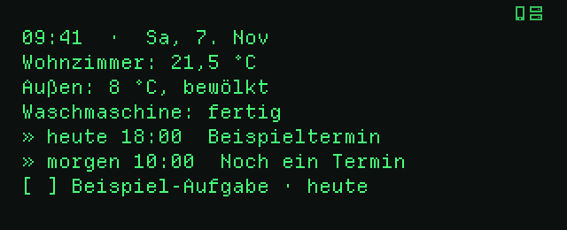 | 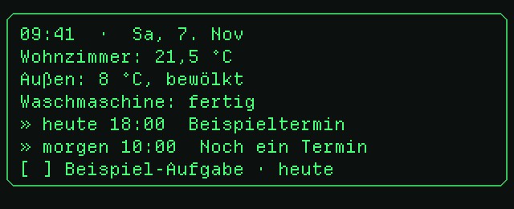 |
| **Karte** | **Titelzeile** |
| 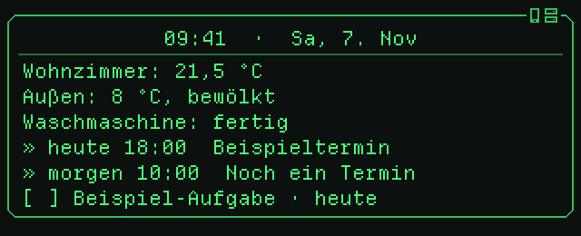 | 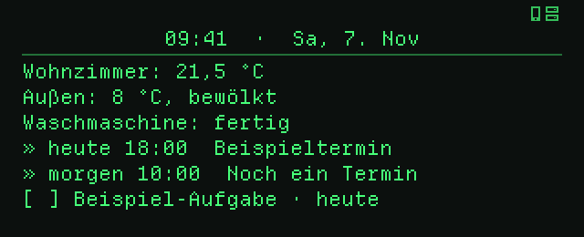 |

Text beim Zuhören (Option *Text beim Zuhören*) und die Animation beim Ruhemodus:

| Assist hört zu | Ruhemodus an | Ruhemodus aus |
| --- | --- | --- |
|  |  |  |

### Design-Set „Labor“

Option *Design-Set → Labor* und *Design des Dashboards → Labor*: Eckklammern
statt Rahmen, der Titel invertiert auf einer Leiste mit Warnstreifen,
getippter Text mit Block-Cursor und eine Scanline, die die Karte wegwischt.
Angelehnt an Retro-Labor-Terminals; Namen oder Logos bestehender Spiele
kommen nicht vor.

| Dashboard | Assist hört zu |
| --- | --- |
| 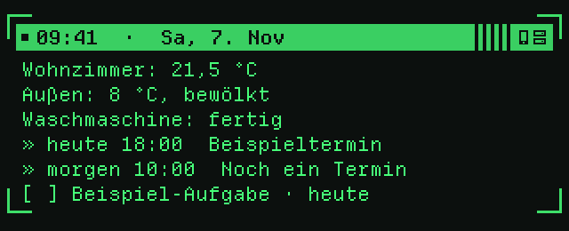 | 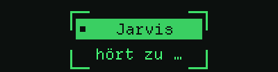 |
| **Ruhemodus an** | **Ruhemodus aus** |
|  | 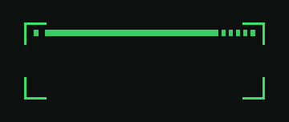 |

Die Antwort von Assist erscheint in einem Terminal-Fenster: der Name des
Assistenten auf der Leiste (mit der Seite, z. B. `2/3`), darunter die
Antwort, am Ende ein Block-Cursor.

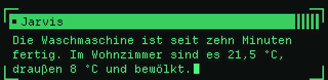

Die Bilder hat ScouterKits eigener Interpreter
(`src/vm`) aus genau den Befehlen gerendert, die die App an die Brille
schickt.

## Firmware: ScouterKit

**ScouterKit** ist eine freie Ersatz-Firmware von
[mafik/scouter_kit](https://github.com/mafik/scouter_kit) (MIT-Lizenz). Sie
ersetzt Evens Firmware auf beiden Bügeln und macht jeden Bügel zu einer kleinen
programmierbaren Maschine; die App spricht deren Protokoll 5. Die App selbst
spielt keine Firmware auf: Das geschieht mit den Werkzeugen von ScouterKit an
einem Linux-Rechner, Schritt für Schritt nach deren
[Anleitung](https://github.com/mafik/scouter_kit/tree/main/g1_firmware).

> **Achtung:** Das Aufspielen lässt sich nicht ungeschehen machen (zurück geht
> nur zu Evens öffentlicher 1.6.6), ein Fehler kann einen Bügel unbrauchbar
> machen, und die Garantie erlischt vermutlich. Lies vorher
> [docs/SCOUTERKIT.de.md](docs/SCOUTERKIT.de.md) und die Anleitung von ScouterKit
> ganz.

Brillen mit Evens Firmware: 0.24.x nutzen, die letzte Version, die sie
unterstützt ([Release v0.24.0](https://github.com/Poldion/Even-G1-Homeassistant/releases/tag/v0.24.0));
sie wird nicht mehr weiterentwickelt.

## Installation

### Integration

**HACS:** *HACS → ⋮ → Benutzerdefinierte Repositories* →
`https://github.com/Poldion/Even-G1-Homeassistant` als *Integration* hinzufügen,
„Even Realities G1“ installieren, Home Assistant neu starten.

**Manuell:** `even_g1-vX.Y.Z.zip` von der
[Releases-Seite](https://github.com/Poldion/Even-G1-Homeassistant/releases/latest)
nach `config/custom_components/even_g1/` entpacken und Home Assistant neu
starten.

Danach *Einstellungen → Geräte & Dienste → Integration hinzufügen →
„Even Realities G1“*.

### App (Android)

Die neueste `even-g1-ha-….apk` von der
[Releases-Seite](https://github.com/Poldion/Even-G1-Homeassistant/releases)
auf dem Handy herunterladen und installieren. Danach aktualisiert sich die
App selbst: Sie sucht einmal am Tag nach einer neuen Version (oder unter
*Einstellungen → App-Update*) und installiert sie auf Nachfrage. Beim ersten
Update fragt Android einmalig, ob die App Apps installieren darf. Die
Einstellungen bleiben erhalten.

**Releases:** Ein Release `vX.Y.Z` enthält App und Integration, und HACS
bietet es als Update an. Hat sich nur die App geändert, heißt das Release
`app-vX.Y.Z` und ist auf GitHub als Pre-release markiert: HACS bietet es
nicht an, Home Assistant muss nicht neu starten, und die App installiert es
wie jede andere Version. Die Integration braucht also nur ein Update, wenn
es ein Release `vX.Y.Z` gibt.


Die Brille im offenen Ladeetui koppeln (Details in
[docs/SCOUTERKIT.de.md](docs/SCOUTERKIT.de.md)).

**Beta-Builds:** Jeder Stand von `main` erscheint als Beta-Build
(GitHub-Pre-release `sk-vX.Y.Z.N`). Wer sie haben will, wählt unter
*Einstellungen → App-Update* den Kanal **Beta-Version**.

## Einrichtung

1. In Home Assistant ein Token erstellen: *Profil → Sicherheit → Langlebige Zugriffstoken*.
2. In der App unter *Einstellungen → Home Assistant* URL und Token eintragen, *Verbinden & Brillen aus HA laden*, Brille wählen, *Speichern*.
3. Unter *Einstellungen → Brille koppeln* nach Brillen suchen und deine G1 antippen.
4. Optional *Einstellungen → Benachrichtigungen → Erlauben*. Meldet Android „App wurde Zugriff verweigert“: *Android-Einstellungen → Apps → Even G1 HA → ⋮ → Eingeschränkte Einstellungen zulassen*, dann erneut erlauben.
5. Für stabilen Betrieb im Hintergrund die Akku-Optimierung für die App deaktivieren.

## Bedienung

### An der Brille

| Geste | Aktion |
| --- | --- |
| Linke Touchbar gedrückt halten | Assist: sprechen, solange gedrückt (max. 30 s) |
| Tippen links / rechts | Seite zurück / vor |
| Doppeltippen | Anzeige schließen, Assist abbrechen |
| Dreifachtippen | Ruhemodus an/aus |
| Hochschauen | Home-Assistant-Dashboard (wenn als Dashboard-Geste gewählt); beim Navigieren die nächste Abbiegung |
| Rechte Touchbar gedrückt halten | Geste `long_press_right` für eigene Automationen |
| Nicken / Kopfschütteln | Unter *Anzeige & Aktivierung → Kopfgesten*: Gesten `nod` / `head_shake` |

### In der App

- **Übersicht:** Verbindung, Akku links/rechts und Case, Trage-Zustand, Ruhemodus, Helligkeit (Regler, Automatik mit Offset), Home Assistant und Assistent, optionale Vorschau der Brillenanzeige.
- **Einstellungen:** Home Assistant, Brille koppeln, *Anzeige & Aktivierung* (Aktivierungswinkel, Höhe, Kopfgesten), Benachrichtigungen, Sprache, Diagnose.

### Navigation

Navigiert Google Maps auf dem Handy, zeigt die Brille die nächste
Abbiegung: mit dem Pfeil aus Maps, der Entfernung und der Anweisung bei
jeder neuen Abbiegung und bei 500, 200 und 50 m (für 6 Sekunden); beim
Hochschauen ersetzt die Abbiegung das Dashboard, bis die Navigation endet.
Dafür braucht die App den Zugriff auf Benachrichtigungen (*Einstellungen →
Benachrichtigungen*), dort schaltet *Google-Maps-Navigation* sie ab. Im
Ruhemodus erscheint nichts.

| Neue Abbiegung | Hochschauen beim Navigieren |
| --- | --- |
| 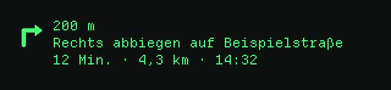 | 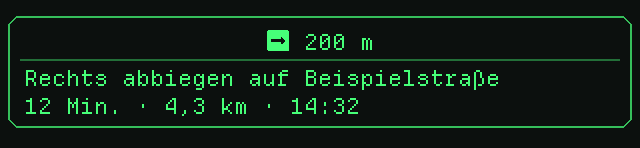 |

### In Home Assistant

Optionen unter *Integration → Konfigurieren*:

| Option | Bedeutung |
| --- | --- |
| Assistent | Welche Assist-Pipeline antwortet (auch über die Entität „Assistent“) |
| Erkannte Frage anzeigen | Zeigt nach dem Loslassen die erkannte Frage |
| Text beim Zuhören | Template, das im Rahmen erscheint, solange du die Touchbar hältst (Standard `{{ assistent }}` + „hört zu …“; `assistant` geht auch) |
| Automatische Verstärkung / Rauschunterdrückung | Hilft bei leiser Sprache bzw. lauter Umgebung |
| Standard-Anzeigedauer | Sekunden bis zum Ausblenden (0 = bis Doppeltippen) |
| Dashboard-Geste | Kopf gehoben, Tippen links oder rechts |
| Design des Dashboards | Schlicht, Rahmen, Karte (Rahmen mit Titelzeile), Titelzeile oder Labor |
| Design-Set | Aussehen des Assist-Status, der Antworten und der Ruhemodus-Animation, klassisch oder Labor |
| Dashboard-Entitäten | Zeilen „Name: Zustand Einheit“ auf dem Brillen-Dashboard |
| Kalender | Termine von heute (noch nicht vorbei) und morgen |
| To-do-Listen | Offene To-dos mit Fälligkeitsdatum, die dringendsten zuerst |
| Eigenes Dashboard-Template | Leer lassen für das Standard-Layout; sonst Jinja-Template unter den Entitäten (Variablen deutsch und englisch, z. B. `kopfzeile` / `header`) |

Beispiele für eigene Dashboards (Wetter, Zuhause, Energie, nur wichtige Hinweise, Text beim Zuhören) stehen in [docs/DASHBOARD.de.md](docs/DASHBOARD.de.md).

Das Standard-Dashboard passt auf eine Seite der Brille:

```
14:35  ·  Mo, 2. Nov  ·  +2
» heute  Geburtstag Anna
» 15:00  Zahnarzt
» morgen 09:00  Teammeeting
[ ] Müll raus · morgen
```

Erste Zeile Uhrzeit und Datum, `+2` heißt: zwei weitere Einträge passen
nicht mehr drauf. Termine (`»`) kommen zuerst, mindestens eine Zeile bleibt
für To-dos (`[ ]`, überfällig `[!]`). Ohne Einträge steht dort nur Uhrzeit und
Datum. In eigenen Templates stehen die Variablen `kopfzeile`, `agenda` und
`agenda_mehr` und `uhr` zur Verfügung (englisch: `header`, `agenda`,
`agenda_more`, `clock`). Die Uhrzeit läuft auf der Brille selbst
([Details](docs/DASHBOARD.de.md#die-bausteine)).

Die Assist-Pipeline braucht eine Spracherkennung (z. B. *Home Assistant
Cloud* oder *Whisper*); *Speech-to-Phrase* versteht nur feste Befehle.

### Aufnahmen (WhisperNotes → BasaltNotes)

1. In der App unter *Einstellungen → Aufnahmen* die Adresse von WhisperNotes
   eintragen (z. B. `http://192.168.1.10:8000`), bei Bedarf den API-Schlüssel.
2. In WhisperNotes unter *Einstellungen → BasaltNotes* die Verbindung und einen
   **Standard-Vault** einrichten.
3. Aufnahme starten: auf der Übersicht der App mit *Start* oder in Home
   Assistant mit `switch.<name>_aufnahme`. Solange das Mikrofon an ist
   (Aufnahme oder Assist), steht oben rechts im rechten Auge ein kleines
   Mikrofon: Sein Kopf ist das Quadrat, das die Firmware immer zeichnet,
   solange das Mikrofon zuhört; Halterung, Stiel und Fuß ergänzt die App.
   Während einer Aufnahme steht im Dashboard außerdem klein oben links im
   Rahmen `BasaltNotes nimmt auf`.

   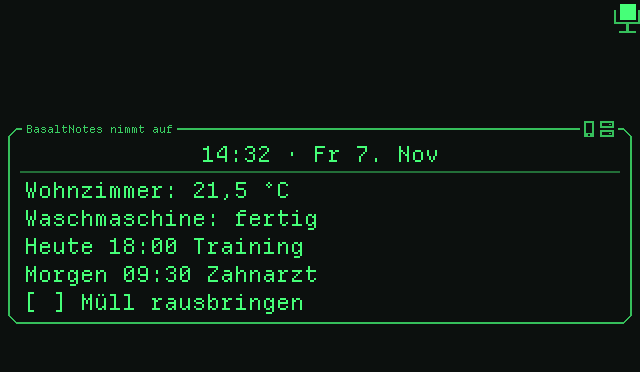
4. Beim Stoppen schickt die App die Aufnahme an WhisperNotes. Dort wird sie
   transkribiert und zusammengefasst; die Zusammenfassung kommt als Notiz in
   den Eingang von BasaltNotes. Ohne Verbindung bleibt die Aufnahme in der App
   und wird später gesendet.

Bitte nur mit Einverständnis aller Anwesenden aufnehmen.

## Home-Assistant-Referenz

### Aktionen

```yaml
action: even_g1.show_text
data:
  title: Waschmaschine
  message: Die Wäsche ist fertig.
  duration: 15          # optional, Sekunden; 0 = bis Doppeltippen
  mode: screen          # oder "notification"
```

`even_g1.clear` schließt die Anzeige, `even_g1.show_dashboard` zeigt das
Dashboard. Außerdem gibt es `notify.<name>` für `notify.send_message`.

### Entitäten

| Entität | Beschreibung |
| --- | --- |
| `select.<name>_assistent` | Assistent der Brille |
| `switch.<name>_ruhemodus` | Ruhemodus |
| `switch.<name>_aufnahme` | Aufnahme mit dem Brillen-Mikrofon; beim Ausschalten geht sie an WhisperNotes |
| `sensor.<name>_akku_links` / `_akku_rechts` / `_akku_case` | Akkustand |
| `binary_sensor.<name>_case_ladt` | Case hängt am Ladekabel |
| `binary_sensor.<name>_getragen` | Brille wird getragen |
| `switch.<name>_trageerkennung` | Bleibt zur Kompatibilität; die Brille erkennt das Tragen immer |
| `sensor.<name>_zustand` | `worn`, `not_worn`, `case_open`, `case_closed` |
| `binary_sensor.<name>_brille_verbunden` / `_app_verbunden` | Verbindungen |
| `sensor.<name>_letzte_frage` / `_letzte_antwort` | Letzte Assist-Interaktion |
| `event.<name>_geste` | `single_tap_left`, `single_tap_right`, `double_tap`, `triple_tap`, `head_up`, `head_down`, `long_press`, `long_press_release`, `other`, `long_press_right`, `long_press_right_release`, `nod`, `head_shake` |

Events: `even_g1_gesture` (`device_id`, `gesture`, `side`, `code`) und
`even_g1_assist` (`device_id`, `query`, `response`).

### Beispiele

```yaml
automation:
  - alias: G1 – Wetter bei Tippen rechts
    triggers:
      - trigger: state
        entity_id: event.even_g1_geste
        attribute: event_type
        to: single_tap_right
    actions:
      - action: even_g1.show_text
        data:
          title: Wetter
          message: "{{ state_attr('weather.home', 'temperature') }} °C"
          duration: 8

  - alias: G1 – Ruhemodus nachts
    triggers:
      - trigger: time
        at: "22:30:00"
    actions:
      - action: switch.turn_on
        target:
          entity_id: switch.even_g1_ruhemodus
```

## Hinweise

- Technische Details: [docs/TECHNICAL.de.md](docs/TECHNICAL.de.md) und [docs/SCOUTERKIT.de.md](docs/SCOUTERKIT.de.md).
- Die Bluetooth-Bibliothek [flutter_blue_plus](https://pub.dev/packages/flutter_blue_plus) ist nur für nicht-kommerzielle Nutzung frei.
- Kein offizielles Produkt von Even Realities.
- ScouterKit ist ein Projekt von Dritten ([mafik/scouter_kit](https://github.com/mafik/scouter_kit)) und nicht Teil dieses Repositorys. Fragen zur Firmware selbst gehören dorthin.

## Danksagung und Lizenzen Dritter

- [ScouterKit](https://github.com/mafik/scouter_kit) (MIT): Firmware g1v0, Protokoll 5 und VM, deren Interpreter die Programme dieser App lokal geprüft hat.
- Benachrichtigungssymbole: Pebbles Symbole aus [PebbleOS](https://github.com/coredevices/PebbleOS) und [pebble-dev/iconography](https://github.com/pebble-dev/iconography), wie ScouterKit sie umwandelt (Apache License 2.0, siehe `app/assets/scouter/icons/NOTICE`).
- Schrift [Departure Mono](https://departuremono.com/) von Helena Zhang (SIL Open Font License 1.1, `app/assets/scouter/DepartureMono-LICENSE.txt`).
- Emojis: [Noto Emoji](https://github.com/googlefonts/noto-emoji) (einfarbig) von Google, gerastert zu 22-px-Glyphen (SIL Open Font License 1.1, `app/assets/scouter/LICENSE.noto-emoji`).
- Protokollwissen zur Even-Firmware (Versionen bis 0.24) aus [MentraOS](https://github.com/Mentra-Community/MentraOS), [even-g1-companion](https://github.com/Cheddies1/even-g1-companion), [g1-reverse](https://github.com/FreedomCoder-dev/g1-reverse) und dem [EvenDemoApp-Wiki](https://github.com/JohnRThomas/EvenDemoApp/wiki/Even-Realities-G1-BLE-Protocol).

## Weitere Dokumentation

- [Änderungen](CHANGELOG.de.md)
- [Technische Details und Protokoll](docs/TECHNICAL.de.md)
- [ScouterKit (g1v0): Installation und Technik](docs/SCOUTERKIT.de.md) · [Firmware-Repository](https://github.com/mafik/scouter_kit)
- [Entwicklung, Tests und Releases](docs/DEVELOPMENT.de.md)
