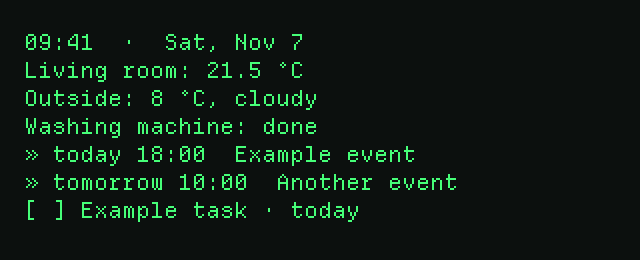
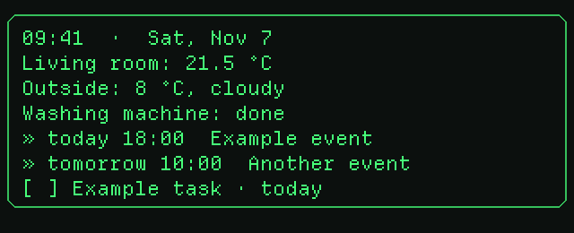
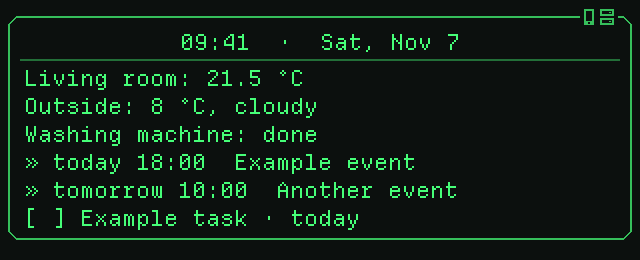
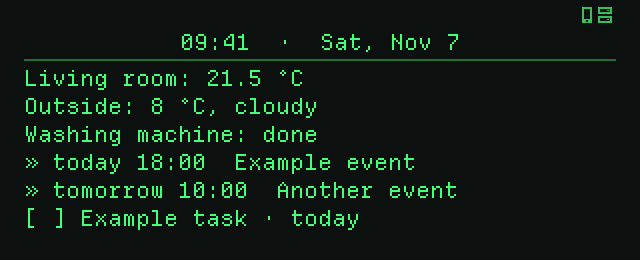
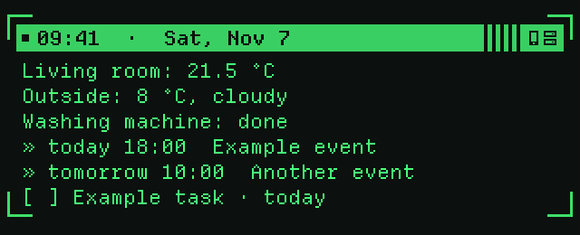
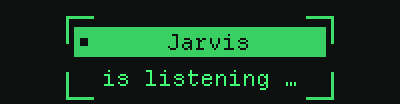
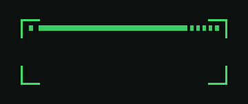
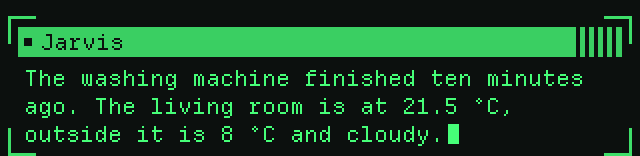
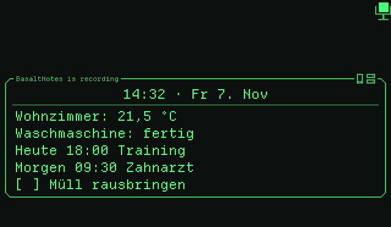

# Even Realities G1 for Home Assistant

**English** | [Deutsch](README.de.md)

[](https://github.com/Poldion/Even-G1-Homeassistant/releases/latest)
[](https://github.com/Poldion/Even-G1-Homeassistant/actions/workflows/integration.yml)
[](https://github.com/Poldion/Even-G1-Homeassistant/actions/workflows/app.yml)

Connects the **Even Realities G1** smart glasses with **Home Assistant**: show
texts and your own dashboard on the glasses, talk to your assistant and use
the glasses in automations. It consists of an **Android app** that connects
the glasses via Bluetooth and a **Home Assistant integration**.

The glasses run the free replacement firmware
**[ScouterKit (g1v0)](https://github.com/mafik/scouter_kit)**, which unlocks
the whole display and all sensors of the glasses (see
[Firmware](#firmware-scouterkit)).

> **Since 0.25.0 the app works only with ScouterKit.** Even's own firmware
> is no longer developed further: 0.24.x is the last version for it (the app
> offers glasses with Even's firmware no newer version), and the branch
> [`legacy`](https://github.com/Poldion/Even-G1-Homeassistant/tree/legacy)
> stays as it is.

## Features

- **Texts on the glasses** via action, notify entity or automation, e.g. "Washing machine done"
- **Assist:** hold the left touch bar, speak, release; your assistant's answer appears on the glasses
- **Dashboard for the glasses** with time, date, entities, appointments and to-dos on one page, optionally when you look up
- **Recordings** with the glasses' microphone, started in the app or in Home Assistant; [WhisperNotes](https://github.com/Poldion/WhisperNotes) transcribes and summarizes, the summary ends up in [BasaltNotes](https://github.com/Poldion/BasaltNotes)
- **Phone notifications** on the glasses, selectable per app
- **Silent mode**, battery of glasses and case, wear state and gestures as entities
- Texts on the whole display (11 lines of 42 characters), both eyes exactly in sync, app icons for notifications, dashboard on head up straight from the glasses (also without the phone, with its own clock), nodding and shaking the head as gestures, brightness offset on top of auto brightness, emojis, dashboard designs with frame and title, your own text while Assist listens and an animation for silent mode

## Language

App and integration are available in **English** and **German**. The app
follows the phone's language; you can switch it under *Settings → Language*.
The integration follows the language of Home Assistant. Template variables
have English and German names (for example `header` / `kopfzeile`).

## What it looks like

Dashboard designs (option *Dashboard design*), as the glasses draw them. The
content is made up.

| Plain | Frame |
| --- | --- |
|  |  |
| **Card** | **Title** |
|  |  |

Text while listening (option *Text while listening*) and the silent mode
animation:

| Assist is listening | Silent mode on | Silent mode off |
| --- | --- | --- |
|  |  |  |

### Lab design set

Option *Design set → Lab* plus *Dashboard design → Lab*: corner brackets
instead of frames, the title inverted on a bar with hazard stripes, typed text
with a block cursor and a scan line that wipes the card away. Inspired by retro
lab terminals; no names or logos of existing games are used.

| Dashboard | Assist is listening |
| --- | --- |
|  |  |
| **Silent mode on** | **Silent mode off** |
|  |  |

Assist's answer appears in a terminal window: the assistant's name on the
bar (with the page, e.g. `2/3`), the answer below, a block cursor at its end.



The images were rendered by ScouterKit's own interpreter (`src/vm`) from
exactly the commands the app sends to the glasses.

## Firmware: ScouterKit

**ScouterKit** is a free replacement firmware by
[mafik/scouter_kit](https://github.com/mafik/scouter_kit) (MIT license). It
replaces Even's firmware on both arms and turns each arm into a small
programmable machine; the app speaks its protocol 5. The app itself does not
flash any firmware: that is done with ScouterKit's tools on a Linux computer,
step by step following their
[guide](https://github.com/mafik/scouter_kit/tree/main/g1_firmware).

> **Warning:** Flashing cannot be undone (you can only go back to Even's
> public 1.6.6), a mistake can brick an arm, and the warranty is probably
> void. Read [docs/SCOUTERKIT.md](docs/SCOUTERKIT.md) and ScouterKit's guide
> completely first.

Glasses with Even's firmware: use 0.24.x, the last version that supports
it ([release v0.24.0](https://github.com/Poldion/Even-G1-Homeassistant/releases/tag/v0.24.0));
it is no longer developed further.

## Installation

### Integration

**HACS:** *HACS → ⋮ → Custom repositories* →
add `https://github.com/Poldion/Even-G1-Homeassistant` as *Integration*,
install "Even Realities G1", restart Home Assistant.

**Manual:** extract `even_g1-vX.Y.Z.zip` from the
[releases page](https://github.com/Poldion/Even-G1-Homeassistant/releases/latest)
to `config/custom_components/even_g1/` and restart Home Assistant.

Then *Settings → Devices & services → Add integration →
"Even Realities G1"*.

### App (Android)

Download `even-g1-ha-vX.Y.Z.apk` from the
[releases page](https://github.com/Poldion/Even-G1-Homeassistant/releases/latest)
on your phone and install it. After that the app updates itself: it looks
for a new version once a day (or under *Settings → App update*) and installs
it when you confirm. On the first update Android asks once whether the app
may install apps. Your settings are kept.

App and integration should have the same version.

Pair the glasses in the open charging case (details in
[docs/SCOUTERKIT.md](docs/SCOUTERKIT.md)).

**Previews:** every state of `main` is published as a pre-release
`sk-vX.Y.Z.N`. If you want them, choose the channel **Preview** under
*Settings → App update*.

## Setup

1. Create a token in Home Assistant: *Profile → Security → Long-lived access tokens*.
2. In the app under *Settings → Home Assistant* enter URL and token, *Connect & load glasses from HA*, choose your glasses, *Save*.
3. Under *Settings → Pair glasses* search for glasses and tap your G1.
4. Optionally *Settings → Notifications → Allow*. If Android reports "App was denied access": *Android settings → Apps → Even G1 HA → ⋮ → Allow restricted settings*, then allow again.
5. For reliable background operation disable battery optimization for the app.

## Usage

### On the glasses

| Gesture | Action |
| --- | --- |
| Hold the left touch bar | Assist: speak while holding (max. 30 s) |
| Tap left / right | Page back / forward |
| Double tap | Close the display, cancel Assist |
| Triple tap | Silent mode on/off |
| Look up | Home Assistant dashboard (if chosen as dashboard gesture) |
| Hold the right touch bar | Gesture `long_press_right` for your own automations |
| Nod / shake the head | Under *Display & activation → Head gestures*: gestures `nod` / `head_shake` |

### In the app

- **Overview:** connection, battery left/right and case, wear state, silent mode, brightness (slider, auto with offset), Home Assistant and assistant, optional preview of the glasses' display.
- **Settings:** Home Assistant, pair glasses, *Display & activation* (activation angle, height, head gestures), notifications, language, diagnostics.

### In Home Assistant

Options under *Integration → Configure*:

| Option | Meaning |
| --- | --- |
| Assistant | Which Assist pipeline answers (also via the "Assistant" entity) |
| Show recognized question | Shows the recognized question after releasing |
| Text while listening | Template shown in a frame while you hold the touch bar (default `{{ assistant }}` + "is listening …"; `assistent` works too) |
| Automatic gain / noise suppression | Helps with quiet speech or noisy surroundings |
| Default display duration | Seconds until hidden (0 = until double tap) |
| Dashboard gesture | Head up, tap left or right |
| Dashboard design | Plain, frame, card (frame with title), title or lab |
| Design set | Look of the Assist status, answers and the silent mode animation, classic or lab |
| Dashboard entities | Lines "Name: state unit" on the glasses dashboard |
| Calendars | Appointments of today (not yet over) and tomorrow |
| To-do lists | Open to-dos with a due date, the most urgent first |
| Own dashboard template | Leave empty for the built-in layout; otherwise a Jinja template below the entities (variables in English and German, e.g. `header` / `kopfzeile`) |

Examples for your own dashboards (weather, home, energy, only important
notes, text while listening) are in [docs/DASHBOARD.md](docs/DASHBOARD.md).

The built-in dashboard fits on one page of the glasses:

```
14:35  ·  Mon, Nov 2  ·  +2
» today  Example birthday
» 15:00  Example appointment
» tomorrow 09:00  Team meeting
[ ] Example task · tomorrow
```

The first line shows time and date, `+2` means: two more entries do not fit.
Appointments (`»`) come first, at least one line is kept for to-dos (`[ ]`,
overdue `[!]`). Without entries only time and date are shown. Own templates
can use the variables `header`, `agenda`, `agenda_more` and `clock` (German:
`kopfzeile`, `agenda`, `agenda_mehr`, `uhr`). The time runs on the glasses
themselves ([details](docs/DASHBOARD.md#the-building-blocks)).

The Assist pipeline needs speech recognition (e.g. *Home Assistant Cloud* or
*Whisper*); *Speech-to-Phrase* only understands fixed commands.

### Recordings (WhisperNotes → BasaltNotes)

1. In the app under *Settings → Recordings* enter the address of WhisperNotes
   (e.g. `http://192.168.1.10:8000`), and the API key if needed.
2. In WhisperNotes under *Settings → BasaltNotes* set up the connection and a
   **default vault**.
3. Start a recording: on the app's overview with *Start* or in Home Assistant
   with `switch.<name>_recording`. While the microphone is on (recording or
   Assist), a small microphone shows in the top right corner of the right
   eye: its head is the square the firmware always draws while the
   microphone listens, the app adds holder, stem and base. During a
   recording the dashboard also says `BasaltNotes is recording` in small
   letters on the top left of its frame.

   
4. When you stop, the app sends the recording to WhisperNotes. There it is
   transcribed and summarized; the summary arrives as a note in the BasaltNotes
   inbox. Without a connection the recording stays in the app and is sent
   later.

Please only record with the consent of everyone present.

## Home Assistant reference

### Actions

```yaml
action: even_g1.show_text
data:
  title: Washing machine
  message: The laundry is done.
  duration: 15          # optional, seconds; 0 = until double tap
  mode: screen          # or "notification"
```

`even_g1.clear` closes the display, `even_g1.show_dashboard` shows the
dashboard. There is also `notify.<name>` for `notify.send_message`.

### Entities

Entity IDs follow the language Home Assistant had when the integration was
set up; the English names are listed here.

| Entity | Description |
| --- | --- |
| `select.<name>_assistant` | Assistant of the glasses |
| `switch.<name>_silent_mode` | Silent mode |
| `switch.<name>_recording` | Recording with the glasses' microphone; when switched off it goes to WhisperNotes |
| `sensor.<name>_battery_left` / `_battery_right` / `_case_battery` | Battery level |
| `binary_sensor.<name>_case_charging` | Case is connected to the charging cable |
| `binary_sensor.<name>_worn` | Glasses are worn |
| `switch.<name>_wear_detection` | Kept for compatibility; the glasses always detect wearing |
| `sensor.<name>_state` | `worn`, `not_worn`, `case_open`, `case_closed` |
| `binary_sensor.<name>_glasses_connected` / `_app_connected` | Connections |
| `sensor.<name>_last_question` / `_last_answer` | Last Assist interaction |
| `event.<name>_gesture` | `single_tap_left`, `single_tap_right`, `double_tap`, `triple_tap`, `head_up`, `head_down`, `long_press`, `long_press_release`, `other`, `long_press_right`, `long_press_right_release`, `nod`, `head_shake` |

Events: `even_g1_gesture` (`device_id`, `gesture`, `side`, `code`) and
`even_g1_assist` (`device_id`, `query`, `response`).

### Examples

```yaml
automation:
  - alias: G1 – weather on tap right
    triggers:
      - trigger: state
        entity_id: event.even_g1_gesture
        attribute: event_type
        to: single_tap_right
    actions:
      - action: even_g1.show_text
        data:
          title: Weather
          message: "{{ state_attr('weather.home', 'temperature') }} °C"
          duration: 8

  - alias: G1 – silent mode at night
    triggers:
      - trigger: time
        at: "22:30:00"
    actions:
      - action: switch.turn_on
        target:
          entity_id: switch.even_g1_silent_mode
```

## Notes

- Technical details: [docs/TECHNICAL.md](docs/TECHNICAL.md) and [docs/SCOUTERKIT.md](docs/SCOUTERKIT.md).
- The Bluetooth library [flutter_blue_plus](https://pub.dev/packages/flutter_blue_plus) is free for non-commercial use only.
- Not an official Even Realities product.
- ScouterKit is a third-party project ([mafik/scouter_kit](https://github.com/mafik/scouter_kit)) and not part of this repository. Questions about the firmware itself belong there.

## Acknowledgements and third-party licenses

- [ScouterKit](https://github.com/mafik/scouter_kit) (MIT): firmware g1v0, protocol 5 and VM, whose interpreter was used to check this app's programs locally.
- Notification icons: Pebble's icons from [PebbleOS](https://github.com/coredevices/PebbleOS) and [pebble-dev/iconography](https://github.com/pebble-dev/iconography), as converted by ScouterKit (Apache License 2.0, see `app/assets/scouter/icons/NOTICE`).
- Font [Departure Mono](https://departuremono.com/) by Helena Zhang (SIL Open Font License 1.1, `app/assets/scouter/DepartureMono-LICENSE.txt`).
- Emojis: [Noto Emoji](https://github.com/googlefonts/noto-emoji) (monochrome) by Google, rasterised to 22-px glyphs (SIL Open Font License 1.1, `app/assets/scouter/LICENSE.noto-emoji`).
- Protocol knowledge about Even's firmware (versions up to 0.24) from [MentraOS](https://github.com/Mentra-Community/MentraOS), [even-g1-companion](https://github.com/Cheddies1/even-g1-companion), [g1-reverse](https://github.com/FreedomCoder-dev/g1-reverse) and the [EvenDemoApp wiki](https://github.com/JohnRThomas/EvenDemoApp/wiki/Even-Realities-G1-BLE-Protocol).

## More documentation

- [Changelog](CHANGELOG.md)
- [Technical details and protocol](docs/TECHNICAL.md)
- [ScouterKit (g1v0): installation and technique](docs/SCOUTERKIT.md) · [firmware repository](https://github.com/mafik/scouter_kit)
- [Development, tests and releases](docs/DEVELOPMENT.md)
