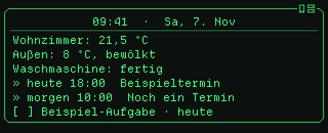
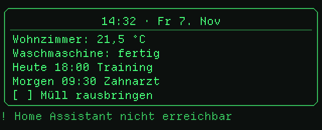

# Dashboards für die Brille

[English](DASHBOARD.md) | **Deutsch**

Das Dashboard ist ein Text, den Home Assistant aus einem Template rendert und
die App bei jeder Änderung auf die Brille legt. Du stellst es unter
*Einstellungen → Geräte & Dienste → Even Realities G1 → Konfigurieren* ein.



## Die Bausteine

| Option | Wirkung |
| --- | --- |
| Dashboard-Geste | Wann es erscheint: beim Hochschauen, beim Tippen links oder rechts, oder nie (dann nur per Aktion `even_g1.show_dashboard`) |
| Design des Dashboards | Nur ScouterKit: schlicht, Rahmen, Karte, Titelzeile oder Labor (Bilder im [README](../README.de.md#so-sieht-es-aus)) |
| Design-Set | Nur ScouterKit: klassisches oder Labor-Aussehen für Assist-Status und Ruhemodus-Animation |
| Dashboard-Entitäten | Je Entität eine Zeile „Name: Zustand Einheit“, ganz oben |
| Kalender / To-do-Listen | Termine von heute und morgen, fällige To-dos |
| Eigenes Dashboard-Template | Ersetzt das Standard-Layout unter den Entitäten-Zeilen |

Ohne eigenes Template besteht das Dashboard aus Kopfzeile (Uhrzeit und Datum),
den Entitäten-Zeilen und der Agenda. Ein eigenes Template ist ein normales
[Home-Assistant-Template](https://www.home-assistant.io/docs/configuration/templating/)
und kann zusätzlich diese Variablen nutzen:

| Variable | Inhalt |
| --- | --- |
| `kopfzeile` | `09:41  ·  Sa, 7. Nov`, mit `  ·  +N`, wenn Termine nicht mehr passen |
| `agenda` | Termine und To-dos, eine Zeile pro Eintrag, schon auf die Seite gekürzt |
| `agenda_mehr` | Anzahl der Einträge, die nicht mehr auf die Seite passten |
| `uhr` | Die Uhrzeit `HH:MM`, von der Brille selbst geführt (siehe unten) |

Jede Variable gibt es auch mit englischem Namen: `header` statt `kopfzeile`,
`agenda_more` statt `agenda_mehr`, `clock` statt `uhr` (`agenda` heißt in
beiden Sprachen so).

**Die Uhr läuft auf der Brille.** `uhr` (und die Uhrzeit in `kopfzeile`)
ist ein Platzhalter, den die App füllt. Mit ScouterKit zählt das Programm
auf den Bügeln die Minuten selbst und zeichnet genau zur vollen Minute neu,
auf beiden Augen und auch ohne Verbindung zum Handy; die App stellt die Zeit
nur alle paar Minuten nach. Home Assistant schickt das Dashboard deshalb
nicht mehr jede Minute, sondern nur, wenn sich der Inhalt ändert. Mit Evens
Firmware setzt die App die Uhrzeit ein. Schreib `{{ uhr }}` statt
`{{ now().strftime('%H:%M') }}`; die Brille führt eine Uhr pro Dashboard (die
erste).

### Platz auf dem Display

| Firmware | Zeilen | Zeichen pro Zeile |
| --- | --- | --- |
| Even | 5 | etwa 30 |
| ScouterKit | 11 (je nach Höhe 8–14) | 42 |

Längere Zeilen bricht die App um. Mehr Zeilen als eine Seite erscheinen beim
Tippen auf mehreren Seiten; das Dashboard beim Hochschauen zeigt nur die erste.
Leerzeilen bleiben erhalten und eignen sich als Abstand.

Mit den Designs *Karte* und *Titelzeile* wird die **erste Zeile** zentriert als
Titel gesetzt, mit einer Linie darunter. Die Kopfzeile passt dafür gut. Bei
*Labor* steht die erste Zeile dunkel auf einer hellen Leiste mit Warnstreifen,
eingefasst von Eckklammern.

### Tipps zum Schreiben

- Ein Zeilenumbruch im Template ist ein Zeilenumbruch auf der Brille. Mit
  `` entfernst du die Umbrüche um Steuerbefehle herum, sodass
  ausgeblendete Zeilen keine Leerzeilen hinterlassen.
- Das Dashboard rendert neu, sobald sich eine verwendete Entität ändert, und
  jede volle Minute; die App schickt nur, was sich geändert hat. Mit `uhr`
  statt `now()` ändert sich zur neuen Minute nichts, also wird nichts
  geschickt.
- Templates testest du unter *Entwicklerwerkzeuge → Template*. Die Variablen
  `kopfzeile` und `agenda` gibt es dort nicht; ersetze sie zum Testen durch
  einen festen Text.
- Unbekannte Entitäten liefern `unknown`. `states('…') | float(0)` und
  `| default('–')` fangen das ab.

Die Entitäten-IDs in den Beispielen sind Platzhalter. Ersetze sie durch deine.

## Verbindungsstatus

Erreicht die App Home Assistant nicht, steht unter dem Dashboard die Zeile
`! Home Assistant nicht erreichbar`: Was es zeigt, ist so alt wie die letzte
Verbindung. Mit ScouterKit merkt die Brille außerdem selbst, wenn das Handy
weg ist, und zeigt `! Keine Verbindung zum Handy` (die Uhr läuft weiter). Die
Zeile verschwindet, sobald die Verbindung wieder steht (binnen 5 Sekunden).
Mit Evens Firmware gibt es nur die Home-Assistant-Zeile, denn ohne Handy
erreicht die Brille nichts.



## Beispiele

### 1. Uhr und Wetter

Für Evens Firmware mit ihren 5 Zeilen gut geeignet.

```jinja
{{ kopfzeile }}

{{ state_translated(w) }}, {{ state_attr(w, 'temperature') | float(0) | round(0) }} °C
{{ agenda }}
```

```
09:41  ·  Sa, 7. Nov
Bewölkt, 8 °C
» heute 18:00  Beispieltermin
```

### 2. Zuhause auf einen Blick

Zählt offene Fenster und eingeschaltete Lichter, statt jede Entität einzeln
aufzuführen.

```jinja
{{ kopfzeile }}


Innen {{ states('sensor.wohnzimmer_temperatur') | float(0) | round(1) }} °C · Außen {{ states('sensor.aussen_temperatur') | float(0) | round(0) }} °C
{{ fenster | count }} Fenster offen · {{ lichter | count }} Lichter an
{{ agenda }}
```

```
09:41  ·  Sa, 7. Nov
Innen 21.5 °C · Außen 8 °C
1 Fenster offen · 3 Lichter an
» heute 18:00  Beispieltermin
» morgen 10:00  Noch ein Termin
```

### 3. Nur zeigen, was gerade wichtig ist

Zeilen erscheinen nur, wenn es etwas zu sagen gibt. Steht nichts an, bleibt
ein kurzer Hinweis.

```jinja
{{ kopfzeile }}


  


  


  {%- set hinweise = hinweise + ['Handy-Akku: ' ~ states('sensor.handy_akku') ~ ' %'] %}


! {{ h }}


Alles erledigt.

{{ agenda }}
```

```
09:41  ·  Sa, 7. Nov
! Haustür ist offen
! Wäsche ist fertig
» heute 18:00  Beispieltermin
```

### 4. Energie

```jinja
{{ kopfzeile }}



{{ '%-12s%6.0f W' | format('PV', pv) }}
{{ '%-12s%6.0f W' | format('Verbrauch', pv + netz) }}
{{ '%-12s%6.0f W' | format('Einspeisung' if netz < 0 else 'Bezug', netz | abs) }}
{{ '%-12s%6.0f %%' | format('Speicher', speicher) }}
```

Die Brille nutzt eine Schrift mit fester Breite, deshalb stehen Zahlen mit
`format` sauber untereinander:

```
09:41  ·  Sa, 7. Nov
PV            3420 W
Verbrauch      880 W
Einspeisung   2540 W
Speicher        76 %
```

### 5. Morgens anders als abends

```jinja
{{ kopfzeile }}

Guten Morgen!
Außen {{ states('sensor.aussen_temperatur') | float(0) | round(0) }} °C · Regen {{ states('sensor.regenwahrscheinlichkeit') | default('–') }} %

Gute Nacht.
Wecker {{ as_timestamp(states('sensor.handy_naechster_wecker'), 0) | timestamp_custom('%H:%M', default='–') }}

{{ agenda }}
```

### 6. Unterwegs

```jinja
{{ kopfzeile }}
Zur Arbeit: {{ states('sensor.fahrzeit_arbeit') | default('–') }} min


Auto: {{ akku }} %, {{ states('sensor.auto_reichweite') }} km

{{ agenda }}
```

### 7. Agenda mit eigener Überschrift

Die Variablen lassen sich frei anordnen, etwa die Agenda mit Abstand und
Hinweis auf weitere Einträge:

```jinja
{{ kopfzeile }}

Termine & Aufgaben
{{ agenda if agenda else 'Nichts geplant.' }}

… und {{ agenda_mehr }} weitere

```

## Text beim Zuhören

Die Option *Text beim Zuhören* (nur ScouterKit) ist ebenfalls ein Template. Es
erscheint zentriert im Rahmen, solange du die linke Touchbar hältst. Die
Variable `assistent` (englisch `assistant`) enthält den Namen des gewählten
Assistenten.


```jinja
{{ assistent }}
hört zu …
```

```jinja
{{ 'Guten Morgen' if now().hour < 11 else 'Hallo' }}!
Was kann ich tun?
```

```jinja
{{ assistent }} hört zu
{{ states('sensor.wohnzimmer_temperatur') | float(0) | round(1) }} °C drinnen
```

## Dashboard per Automation zeigen

Die Aktion `even_g1.show_dashboard` zeigt das Dashboard unabhängig von der
Geste, zum Beispiel morgens beim Aufsetzen der Brille:

```yaml
automation:
  - alias: Dashboard beim Aufsetzen
    triggers:
      - trigger: state
        entity_id: sensor.even_g1_zustand
        to: worn
    conditions:
      - condition: time
        after: "06:00:00"
        before: "10:00:00"
    actions:
      - action: even_g1.show_dashboard
        data:
          duration: 15
```

Für einzelne Meldungen ohne Dashboard gibt es `even_g1.show_text` (siehe
[README](../README.de.md)).
