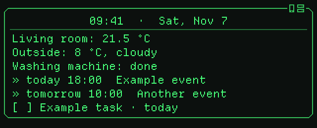
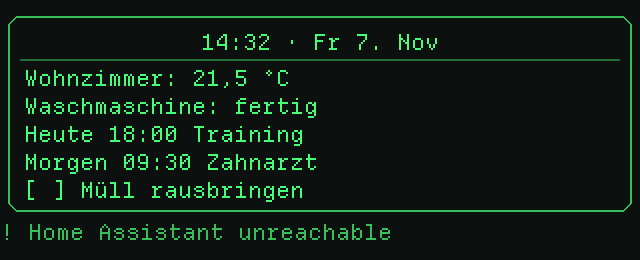
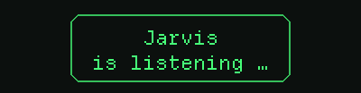

# Dashboards for the glasses

**English** | [Deutsch](DASHBOARD.de.md)

The dashboard is a text that Home Assistant renders from a template and the
app puts on the glasses whenever it changes. You set it up under
*Settings → Devices & services → Even Realities G1 → Configure*.



## The building blocks

| Option | Effect |
| --- | --- |
| Dashboard gesture | When it appears: when you look up, on a tap left or right, or never (then only via the action `even_g1.show_dashboard`) |
| Dashboard design | ScouterKit only: plain, frame, card, title or lab (images in the [README](../README.md#what-it-looks-like)) |
| Design set | ScouterKit only: classic or lab look for the Assist status and the silent mode animation |
| Dashboard entities | One line "Name: state unit" per entity, at the top |
| Calendars / to-do lists | Appointments of today and tomorrow, to-dos that are due |
| Own dashboard template | Replaces the built-in layout below the entity lines |

Without an own template the dashboard consists of the header (time and
date), the entity lines and the agenda. An own template is a normal
[Home Assistant template](https://www.home-assistant.io/docs/configuration/templating/)
and can also use these variables:

| Variable | Content |
| --- | --- |
| `header` | `09:41  ·  Sat, Nov 7`, with `  ·  +N` if appointments no longer fit |
| `agenda` | Appointments and to-dos, one line per entry, already cut to the page |
| `agenda_more` | Number of entries that did not fit on the page |
| `clock` | The time `HH:MM`, kept by the glasses themselves (see below) |

Every variable also has a German name: `kopfzeile` instead of `header`,
`agenda_mehr` instead of `agenda_more`, `uhr` instead of `clock` (`agenda`
is the same in both languages).

**The clock runs on the glasses.** `clock` (and the time in `header`) is a
placeholder that the app fills in. With ScouterKit the program on the arms
counts the minutes itself and redraws exactly at the full minute, on both
eyes and even without a connection to the phone; the app only sets the time
every few minutes. So Home Assistant no longer sends the dashboard every
minute, only when its content changes. With Even's firmware the app fills
in the time. Write `{{ clock }}` instead of `{{ now().strftime('%H:%M') }}`;
the glasses keep one clock per dashboard (the first one).

### Space on the display

| Firmware | Lines | Characters per line |
| --- | --- | --- |
| Even | 5 | about 30 |
| ScouterKit | 11 (8–14 depending on the height) | 42 |

The app wraps longer lines. More lines than one page appear on several pages
when you tap; the dashboard on head up shows only the first one. Empty lines
are kept and work well as spacing.

With the designs *Card* and *Title* the **first line** is centred as a title,
with a rule below it. The header fits that well. With *Lab* the first line
stands dark on a light bar with hazard stripes, framed by corner brackets.

### Tips for writing

- A line break in the template is a line break on the glasses. With `` you remove the line breaks around statements, so hidden lines do
  not leave empty lines behind.
- The dashboard renders again as soon as an entity it uses changes, and
  every full minute; the app only sends what changed. With `clock` instead
  of `now()` nothing changes at a new minute, so nothing is sent.
- Test templates under *Developer tools → Template*. The variables `header`
  and `agenda` do not exist there; replace them with a fixed text for
  testing.
- Unknown entities return `unknown`. `states('…') | float(0)` and
  `| default('–')` catch that.

The entity IDs in the examples are placeholders. Replace them with yours.

## Connection status

If the app cannot reach Home Assistant, a line
`! Home Assistant unreachable` appears below the dashboard: what it shows is
as old as the last connection. With ScouterKit the glasses also notice by
themselves when the phone is gone and show `! No connection to the phone`
(the clock keeps running). The line disappears as soon as the connection is
back (within 5 seconds). With Even's firmware only the Home Assistant line
exists, because without the phone nothing reaches the glasses.



## Examples

### 1. Clock and weather

Well suited for Even's firmware with its 5 lines.

```jinja
{{ header }}

{{ state_translated(w) }}, {{ state_attr(w, 'temperature') | float(0) | round(0) }} °C
{{ agenda }}
```

```
09:41  ·  Sat, Nov 7
Cloudy, 8 °C
» today 18:00  Example appointment
```

### 2. Home at a glance

Counts open windows and lights that are on, instead of listing every entity.

```jinja
{{ header }}


Inside {{ states('sensor.living_room_temperature') | float(0) | round(1) }} °C · Out {{ states('sensor.outside_temperature') | float(0) | round(0) }} °C
{{ windows | count }} windows open · {{ lights | count }} lights on
{{ agenda }}
```

```
09:41  ·  Sat, Nov 7
Inside 21.5 °C · Out 8 °C
1 windows open · 3 lights on
» today 18:00  Example appointment
» tomorrow 10:00  Another appointment
```

### 3. Only show what matters right now

Lines appear only when there is something to say. If nothing is due, a
short note remains.

```jinja
{{ header }}


  


  


  {%- set notes = notes + ['Phone battery: ' ~ states('sensor.phone_battery') ~ ' %'] %}


! {{ n }}


All done.

{{ agenda }}
```

```
09:41  ·  Sat, Nov 7
! Front door is open
! Laundry is done
» today 18:00  Example appointment
```

### 4. Energy

```jinja
{{ header }}



{{ '%-12s%6.0f W' | format('Solar', pv) }}
{{ '%-12s%6.0f W' | format('Consumption', pv + grid) }}
{{ '%-12s%6.0f W' | format('Feed-in' if grid < 0 else 'Grid', grid | abs) }}
{{ '%-12s%6.0f %%' | format('Battery', battery) }}
```

The glasses use a monospaced font, so numbers line up neatly with
`format`:

```
09:41  ·  Sat, Nov 7
Solar         3420 W
Consumption    880 W
Feed-in       2540 W
Battery         76 %
```

### 5. Different in the morning and in the evening

```jinja
{{ header }}

Good morning!
Out {{ states('sensor.outside_temperature') | float(0) | round(0) }} °C · Rain {{ states('sensor.rain_probability') | default('–') }} %

Good night.
Alarm {{ as_timestamp(states('sensor.phone_next_alarm'), 0) | timestamp_custom('%H:%M', default='–') }}

{{ agenda }}
```

### 6. On the road

```jinja
{{ header }}
To work: {{ states('sensor.travel_time_work') | default('–') }} min


Car: {{ charge }} %, {{ states('sensor.car_range') }} km

{{ agenda }}
```

### 7. Agenda with its own heading

The variables can be arranged freely, for example the agenda with some
space and a note about further entries:

```jinja
{{ header }}

Appointments & tasks
{{ agenda if agenda else 'Nothing planned.' }}

… and {{ agenda_more }} more

```

## Text while listening

The option *Text while listening* (ScouterKit only) is a template too. It
appears centred in a frame while you hold the left touch bar. The variable
`assistant` (German `assistent`) holds the name of the chosen assistant.



```jinja
{{ assistant }}
is listening …
```

```jinja
{{ 'Good morning' if now().hour < 11 else 'Hello' }}!
What can I do?
```

```jinja
{{ assistant }} is listening
{{ states('sensor.living_room_temperature') | float(0) | round(1) }} °C inside
```

## Show the dashboard from an automation

The action `even_g1.show_dashboard` shows the dashboard regardless of the
gesture, for example in the morning when you put on the glasses:

```yaml
automation:
  - alias: Dashboard when putting on the glasses
    triggers:
      - trigger: state
        entity_id: sensor.even_g1_state
        to: worn
    conditions:
      - condition: time
        after: "06:00:00"
        before: "10:00:00"
    actions:
      - action: even_g1.show_dashboard
        data:
          duration: 15
```

For single messages without the dashboard there is `even_g1.show_text` (see
the [README](../README.md)).
